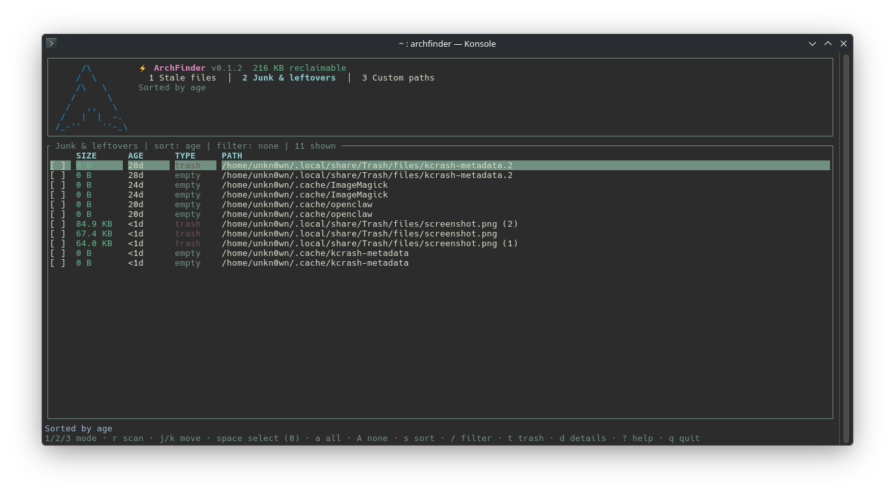

# ArchFinder

<!-- Put your screenshot at docs/screenshot.png (recommended size ~1200x600, PNG or GIF) -->


```
      /\
     /  \
     /\   \        Find and reclaim unused files and folders
    /      \       on Arch Linux — straight from your terminal.
   /   ,,   \
  /   |  |  -.
 /_-''    ''-_\
```

**ArchFinder** is a fast, keyboard-driven TUI that scans for stale files, cache junk,
empty directories and broken symlinks, ranks them by the space they waste, and lets
you move them to the system trash with a single keypress. Nothing is ever deleted
permanently — everything goes to the FreeDesktop trash and can be restored.

## Features

- **⚡ Fast parallel scanning** — multi-threaded directory walk with automatic
  pruning of noisy dirs (`.git`, `node_modules`, caches you want to keep, …)
- **3 detection modes**
  1. **Stale files** — files & folders not modified in N days (default 90),
     ranked by size so the biggest wasters come first
  2. **Junk & leftovers** — `~/.cache` cruft, already-trashed files still
     eating space, empty directories, broken symlinks
  3. **Custom paths** — define your own scan roots, age thresholds and ignore
     rules in `~/.config/archfinder/config.toml`
- **🗑 Safe by design** — trash (never `rm`), confirmation before acting,
  protected paths (`/boot`, `/etc`, `/usr`, `/var`, …) are never touched
- **📄 JSON output** — `archfinder --json` for scripting / piping into other tools
- **⌨️ Full keyboard control** + mouse support

## Install

### With pacman (recommended on Arch)

Download the `.pkg.tar.zst` from the [latest release](https://github.com/farbod2/ArchFinder/releases/latest) and install it:

```bash
sudo pacman -U archfinder-*-x86_64.pkg.tar.zst
```

Or build it yourself with makepkg:

```bash
git clone https://github.com/farbod2/ArchFinder
cd ArchFinder/packaging
makepkg -si
```

> Once published to the [AUR](https://aur.archlinux.org/packages/archfinder), it's a simple
> `paru -S archfinder` / `yay -S archfinder`.

### From source (requires Rust)

```bash
cargo install archfinder
```

### From GitHub Releases

```bash
# x86_64
curl -LO https://github.com/farbod2/ArchFinder/releases/latest/download/archfinder-x86_64-linux.tar.gz
tar xf archfinder-x86_64-linux.tar.gz
sudo mv archfinder /usr/local/bin/
```

## Usage

```bash
archfinder                # open the TUI, stale-files mode (scan your home)
archfinder -R             # open the TUI and scan immediately
archfinder -m 1 -R        # junk & leftovers mode
archfinder --path ~/Projects --min-age 30 --scan
archfinder --json --min-age 365 | jq   # scriptable output
```

### Keys

| Key | Action |
|---|---|
| `j` / `k` / arrows | move |
| `g` / `G` | top / bottom |
| `space` | toggle select |
| `a` / `A` | select all shown / clear |
| `t` | trash selected (asks first) |
| `d` | item details |
| `1` `2` `3` | switch mode |
| `r` | rescan |
| `s` | cycle sort (size / age / name / path) |
| `/` | filter · `Esc` clears |
| `?` | help |
| `q` | quit |

## Configuration

`~/.config/archfinder/config.toml` (created on first save, all fields optional):

```toml
min_age_days = 90
scan_cache = true
scan_trash = true
detect_empty_and_broken = true

# paths never scanned or trashed
protected_paths = ["/mnt/backup"]

# extra names to always ignore
ignore_names = ["Steam", ".steam"]

# mode 3: custom scan roots
[[custom_paths]]
path = "~/Projects"
min_age_days = 180
ignore = ["target", "dist"]
```

## Why not just `rm`?

ArchFinder only moves items to the system trash (`~/.local/share/Trash`), so a
mistake is always reversible — restore from any file manager, or just move the
file back. When you're confident, empty the trash yourself.

## License

MIT — see [LICENSE](LICENSE).
